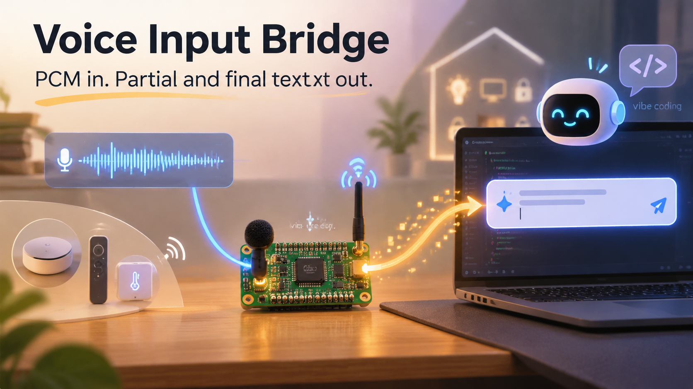
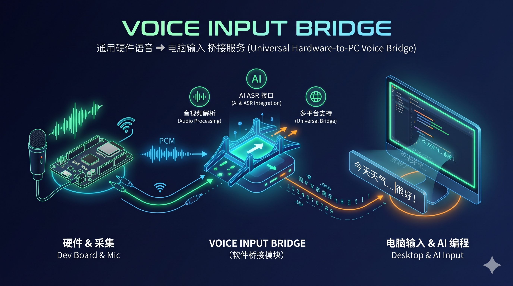
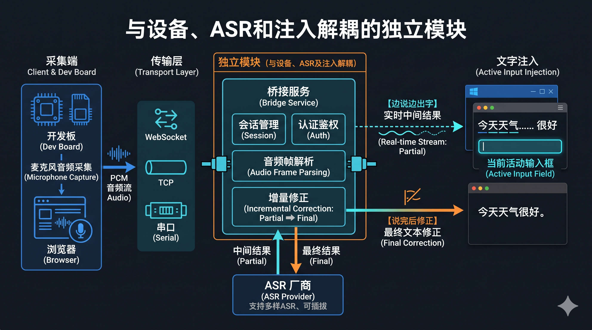
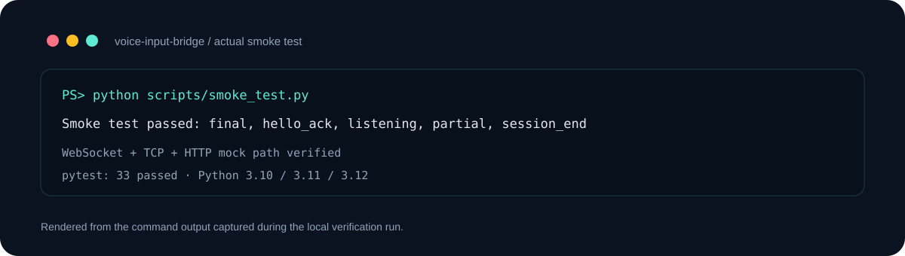

# Voice Input Bridge

[简体中文](README.md) | **English** | [Agent](docs/agent-deployment.md)



Figure 1. AI-generated technical banner showing device audio, the bridge, real-time ASR, and the desktop input field, with vibe coding and smart-home hardware in the background. It is not a third-party product screenshot or runtime evidence.

Voice Input Bridge is a bridge service that injects speech input from various peripherals into desktop text fields.

If you do not understand the details below, copy the paragraph below to your agent and let it configure your device and network:

```text
I am using Voice Input Bridge (https://github.com/albertwickous-droid/voice-input-bridge). Please read the README and docs/hardware-setup.md, then decide whether my setup should use USB serial, wired Ethernet, Wi-Fi, or Bluetooth. If unsure, default to USB serial and give me step-by-step install, configuration, and verification commands. List the exact dependencies, official download URLs, config fields to change, and how to test without committing API keys, tokens, or Wi-Fi passwords.
```

> **Stop rebuilding a separate desktop dictation backend for every device.** If a device can send PCM audio, Voice Input Bridge can route cloud or local ASR `partial` / `final` text into the active Windows or macOS text field.

Voice Input Bridge (`vib`) is a provider-neutral and transport-neutral speech-to-text daemon. An ESP32, M5Stick, browser, phone, or script streams audio over WebSocket, TCP, or USB serial. The bridge owns sessions, audio-format negotiation, incremental text edits, and foreground-window protection.

What is different:

- **The device only captures audio.** Vendor SDKs and desktop APIs stay out of the firmware.
- **ASR is replaceable.** Built-in Alibaba Cloud Paraformer, Deepgram, command-line ASR, and mock providers are available, with Python entry-point plugins for more.
- **Text can appear while speaking.** Providers emit `partial` and `final` events; the bridge applies a common-prefix diff instead of retyping the whole sentence.
- **Local-first by default.** The listener binds to `127.0.0.1`, there is no telemetry, and `.env` files are not loaded automatically.


> **Independent project notice:** This project is not affiliated with, sponsored by, authorized by, or endorsed by Alibaba Cloud, Deepgram, Espressif, Arduino, M5Stack, Microsoft, or Apple. Third-party names identify interoperability only.

## Why now

Trend check: **2026-11-19**

**The most important current use case is vibe coding plus hardware programming.** Recent Xiaomi-remote-style Agent projects have drawn community attention to connecting voice, wireless modules, and real devices. That is a community observation, not a capability or quality claim for this project. Voice Input Bridge is not tied to one remote or one firmware: it is a **standalone speech-recognition module**. Any module that can capture and emit PCM can reuse the same bridge, ASR, and text-injection path over Wi-Fi/WebSocket/TCP or a wired USB serial link.

For an existing M5StickS3, the lowest-cost path is its built-in MEMS microphone and Wi-Fi: install the dependencies and start from the [M5StickS3 example](examples/m5stick_s3_ws_dictation). For a new build, a common low-cost starting point is an ESP32/ESP32-S3 board plus an I2S digital microphone such as INMP441; see [Lowest-cost hardware and dependencies](docs/hardware-setup.md). **You must install the hardware-programming dependencies yourself.** The board only captures and sends audio; recognition runs on the machine hosting the bridge.



Figure 2. AI-generated overview of the three-stage path: hardware and capture, the software bridge module, and desktop/AI input, including real-time partial text and final correction.

| Change | Impact on the user | How this project responds | Primary source |
| --- | --- | --- | --- |
| Vibe coding and hardware programming are converging: developers want natural language to drive real boards and peripherals quickly | Rewriting voice SDKs, desktop injection, and networking for every hardware project is repetitive and fragile | Speech recognition becomes a standalone module; the device sends PCM while the desktop side handles ASR, partial/final text, and text-field injection | [M5StickS3 documentation](https://docs.m5stack.com/en/core/StickS3), [ESP32 Arduino Core](https://docs.espressif.com/projects/arduino-esp32/en/latest/installing.html) |
| Real-time ASR services expose streaming partial/interim results instead of returning text only after a complete recording | Users expect text while speaking, but audio formats, events, and errors differ by vendor | A common `TranscriptEvent` boundary isolates provider differences | [Alibaba Cloud Paraformer Realtime V2](https://help.aliyun.com/zh/model-studio/paraformer-real-time-speech-recognition-api), [Deepgram Docs](https://developers.deepgram.com/docs/live-streaming-audio) |
| Windows and macOS provide system-level keyboard injection with different permissions and foreground-window semantics | One firmware cannot reliably embed every desktop API | Text injection is split into Windows `SendInput`, macOS Quartz, and a clipboard fallback | [Microsoft SendInput](https://learn.microsoft.com/en-us/windows/win32/api/winuser/nf-winuser-sendinput), [Apple CGEvent](https://developer.apple.com/documentation/coregraphics/cgevent) |
| ESP32, browser, and mobile clients can capture PCM continuously and communicate over WebSocket | Devices can stay focused on microphone capture and networking | WebSocket, TCP, serial, and ESP32/M5StickS3 examples are included | [ESP32 product documentation](https://www.espressif.com/en/products/socs/esp32), [WebSocket browser API](https://websockets.spec.whatwg.org/) |

These links establish that the relevant platform capabilities exist. They are not evidence of third-party endorsement, and this project does not treat an industry trend as a performance claim. The popularity of Xiaomi-remote-style projects is only community context here; no star count is cited and no quality evidence is inferred.

## Who it is for

Use it when:

- You have an ESP32, M5Stick, browser, or script and want its audio to become desktop text.
- You want Chinese real-time dictation with the ability to change ASR vendors without rewriting firmware.
- You need a local bridge where you control networking, credentials, and foreground-window behavior.
- You want to dictate into ordinary text fields in Notepad, an IDE, or a chat client.

Do not use it when:

- You need file transcription, subtitles, or batch audio processing.
- You need to bypass permissions, CAPTCHAs, access controls, or system security boundaries.
- You require identical latency and accuracy across every platform, application, and ASR provider.
- You cannot upload audio to a cloud provider and have not deployed a local streaming ASR backend.

## ASR vendors and integration status

Separate **"the vendor offers streaming"** from **"this project already ships an adapter"**. Only `aliyun`, `deepgram`, `mock`, and `command` are built-in providers. Other vendors require a provider plugin or a `command` wrapper; changing one `provider = "vendor"` value is not enough.

Official links checked on **2026-11-19**. Prices vary by region, model, concurrency, and free tier, so this README does not copy stale numbers. Use each row's official documentation, console, or pricing link to verify current terms.

| Region | Vendor / service | Integration in this project | Streaming note | Official entry |
| --- | --- | --- | --- | --- |
| China | Alibaba Cloud Paraformer Realtime V2 | **Built-in `aliyun`** | partial + final; Chinese real-time dictation | [Docs](https://help.aliyun.com/zh/model-studio/paraformer-real-time-speech-recognition-api) · [Console](https://bailian.console.aliyun.com/) · [Pricing](https://help.aliyun.com/zh/model-studio/model-pricing) |
| China | Tencent Cloud real-time ASR | Plugin / custom adapter required | Official streaming API; not built in here | [Docs](https://cloud.tencent.com/document/product/1093) · [Console](https://console.cloud.tencent.com/asr) · [Pricing](https://cloud.tencent.com/document/product/1093/35686) |
| China | iFlytek real-time transcription | Plugin / custom adapter required | Official real-time WebSocket API; implement iFlytek auth | [Docs](https://www.xfyun.cn/doc/asr/rtasr/API.html) · [Console](https://console.xfyun.cn/) |
| China | Baidu Cloud speech recognition | Plugin / custom adapter required | Implement Baidu authentication and audio streaming | [Docs](https://cloud.baidu.com/doc/SPEECH/s/2k5dllqxj) · [Product/pricing](https://cloud.baidu.com/product/speech/asr) |
| China | Volcano Engine streaming ASR | Plugin / custom adapter required | Confirm model, region, and authentication in official docs | [Docs](https://www.volcengine.com/docs/6561/1354869) · [Product/pricing](https://www.volcengine.com/product/asr) |
| China | Huawei Cloud SIS real-time ASR | Plugin / custom adapter required | Official Real-Time ASR request API | [Docs](https://support.huaweicloud.com/intl/en-us/api-sis/sis_03_0029.html) · [Product/pricing](https://www.huaweicloud.com/product/sis.html) |
| Global | Deepgram | **Built-in `deepgram`** | partial + final; WebSocket linear16 | [Docs](https://developers.deepgram.com/docs/live-streaming-audio) · [Pricing](https://deepgram.com/pricing) |
| Global | Microsoft Azure AI Speech | Plugin / custom adapter required | Speech SDK / streaming API | [Docs](https://learn.microsoft.com/en-us/azure/ai-services/speech-service/speech-to-text) · [Pricing](https://azure.microsoft.com/en-us/pricing/details/speech/) |
| Global | Google Cloud Speech-to-Text | Plugin / custom adapter required | Streaming Recognize API | [Docs](https://cloud.google.com/speech-to-text/docs/streaming-recognize) · [Pricing](https://cloud.google.com/speech-to-text/pricing) |
| Global | Amazon Transcribe Streaming | Plugin / custom adapter required | Official streaming API with AWS authentication | [Docs](https://docs.aws.amazon.com/transcribe/latest/dg/streaming.html) · [Pricing](https://aws.amazon.com/transcribe/pricing/) |
| Global | AssemblyAI | Plugin / custom adapter required | Universal Streaming WebSocket | [Docs](https://www.assemblyai.com/docs/streaming/getting-started/transcribe-streaming-audio) · [Pricing](https://www.assemblyai.com/pricing) |
| Global | Speechmatics | Plugin / custom adapter required | Realtime API; use the official WebSocket contract | [Docs](https://docs.speechmatics.com/speech-to-text/realtime/quickstart) · [Pricing](https://www.speechmatics.com/pricing) |
| Global | Soniox | Plugin / custom adapter required | Real-time transcription API | [Docs](https://docs.soniox.com/stt/rt/real-time-transcription) · [Pricing](https://soniox.com/pricing/) |
| Global | OpenAI Speech to Text | Plugin / custom adapter required | Check current streaming/model support in the official docs; not built in here | [Docs](https://platform.openai.com/docs/guides/speech-to-text) · [Pricing](https://openai.com/api/pricing/) |
| Local | whisper.cpp | **Built-in `command` / final-only** | Usually returns after a complete recording; real-time needs a plugin or server mode | [GitHub](https://github.com/ggml-org/whisper.cpp) |
| Local | faster-whisper | **Built-in `command` / final-only** | Usually file or chunk inference; add chunking for streaming | [GitHub](https://github.com/SYSTRAN/faster-whisper) |
| Local | FunASR | **Built-in `command` / final-only** | Use its streaming API inside a custom provider for partials | [GitHub](https://github.com/modelscope/FunASR) |
| Local | Vosk | **Built-in `command` / final-only** | Offline; manage model, memory, and chunking yourself | [GitHub](https://github.com/alphacep/vosk-api) |
| Local | sherpa-onnx | Plugin / custom adapter required | Local inference on multiple platforms; implement a provider for each model/runtime | [GitHub](https://github.com/k2-fsa/sherpa-onnx) |
| Test | mock | **Built-in `mock`** | Deterministic partial + final; no network | [Local docs](docs/providers.md) |


### Selection guide

- **Easiest Chinese real-time dictation:** use built-in `aliyun`.
- **Easiest multilingual/global option:** use built-in `deepgram`.
- **Already have Tencent, iFlytek, Baidu, Volcano, Huawei, Azure, Google, AWS, AssemblyAI, Speechmatics, Soniox, or OpenAI:** write the corresponding provider plugin first; changing a config key alone will not connect it.
- **Offline and final-only is acceptable:** use `command` with whisper.cpp, faster-whisper, FunASR, or Vosk.
- **Offline and partial results are required:** implement a streaming local provider, for example around FunASR or sherpa-onnx; `command` is not a streaming adapter.

See [docs/providers.md](docs/providers.md) for provider contracts and configuration details.

## Transport, injection, and network options

This table separates "the protocol or vendor can do it" from "this project already implements it": only rows marked **built in** can be enabled by configuration alone. Other options require a plugin, reverse proxy, or system configuration.

### Connection mode classification (start here)

| Mode | Included options | Status in this project | Recommendation | Fit and limits |
| --- | --- | --- | --- | --- |
| Wired | USB CDC serial; TCP/WebSocket over wired Ethernet | Serial built in; TCP/WebSocket can run over wired IP | 1 (preferred) | Best latency and stability for a fixed setup near the PC. USB serial requires the device to send `AUD1` PCM frames; it is not USB microphone/UAC capture. |
| Wireless | 2.4 GHz Wi-Fi with WebSocket/TCP; browser Web Audio | Built in | 2 | Flexible and cable-free for ESP32/M5StickS3, phones, and browsers. Requires Wi-Fi, IP, token, firewall configuration, and TLS/VPN across network segments. |
| Bluetooth / BLE | Bluetooth microphones, headsets, BLE audio devices | **Not built in** | 3 (not recommended yet) | The bridge does not read the OS Bluetooth microphone. A device or separate capture client must convert audio to PCM first. BLE bandwidth, codec, and permission limits make it a poor first choice for real-time PCM. |

**Bottom line:** choose wired USB serial when the board is next to the PC; use Wi-Fi when mobility or distance matters; treat Bluetooth as a future custom-capture extension rather than an out-of-the-box path.

| Category | Option | Best fit | Current status / configuration | Caveat | Reference |
| --- | --- | --- | --- | --- | --- |
| Wireless | Wi-Fi / LAN device | ESP32, M5Stick, phone, or another local client | Built in through WebSocket or TCP | The bridge must listen on a reachable address; configure a token, firewall, and encryption boundary | [ESP32 example](examples/esp32/arduino_ws_mic), [troubleshooting](docs/troubleshooting.md#websocket-fails-from-another-machine) |
| Bluetooth | Bluetooth / BLE audio | Bluetooth microphone, headset, or BLE device | **Not built in**; the device or a separate capture client must send PCM | The bridge does not read the OS Bluetooth microphone; bandwidth, codec, and permissions are your responsibility | [Troubleshooting](docs/troubleshooting.md#the-microphone-is-not-the-default-device) |
| Wired | USB microphone / UAC | Ordinary USB microphone or sound card | **Not built in**; a system capture client must convert audio to PCM | The USB serial transport is not USB audio/UAC capture | [Troubleshooting](docs/troubleshooting.md#the-microphone-is-not-the-default-device) |
| Wireless | Browser microphone | In-page recording and local tests | Built-in Web Audio + WebSocket example | Browser permission is required; pages normally need localhost or HTTPS | [Browser example](examples/clients/browser/index.html) |
| Protocol | WebSocket | Browser, ESP32, LAN devices, cross-platform clients | Built in; `transports.websocket.enabled = true` | Use `wss://` behind a TLS proxy; defaults to loopback | [WebSocket standard](https://websockets.spec.whatwg.org/), [protocol](docs/protocol.md#transports) |
| Protocol | TCP | Simple devices or serial gateways | Built in; `transports.tcp.enabled = true` | Plaintext protocol; do not expose directly to the internet | [RFC 9293](https://www.rfc-editor.org/rfc/rfc9293.html), [protocol](docs/protocol.md#transports) |
| Wired | USB serial | USB CDC devices and board debug links | Built in; `[transports.serial]`, `port = "auto"` | Not a USB microphone/UAC path; the device must send `AUD1` frames | [pyserial docs](https://pyserial.readthedocs.io/en/latest/), [architecture](docs/architecture.md#serial) |
| Network | UDP discovery | Local bridge discovery | Optional; enable `[transports.discovery]` | Discovery is unauthenticated metadata only; disabled by default | [Discovery protocol](docs/protocol.md#discovery) |
| Injection | Windows text injection | Normal Windows foreground fields | Built in; `input.backend = "windows"` | Foreground guard; cannot target a higher-integrity process | [Microsoft SendInput](https://learn.microsoft.com/en-us/windows/win32/api/winuser/nf-winuser-sendinput) |
| Injection | macOS text injection | Normal macOS foreground fields | Built in; `input.backend = "macos"` | Accessibility permission required; validate on real macOS | [Apple CGEvent](https://developer.apple.com/documentation/coregraphics/cgevent) |
| Injection | Clipboard fallback | Final-only fallback | Built in; `input.backend = "clipboard"` | Cannot reliably guard the target window; set `require_same_window = false` explicitly | [Input backends](docs/architecture.md#clipboard) |
| Debug | stdout / null | Debugging, CI, protocol tests | Built in; `stdout` / `null` | Does not touch a real text field | [Architecture](docs/architecture.md#components) |
| Injection | Custom InputSink | Special applications or remote injection | `backend = "module:Class"` plugin | Implement `TextSink` and audit the permission boundary | [Extension guide](docs/architecture.md#add-a-text-sink) |
| Network | Loopback | Single-machine use | Default `127.0.0.1` | Smallest exposure surface | [Security](SECURITY.md) |
| Network | LAN + token | Trusted local devices | `host = "0.0.0.0"` + token + firewall | Token authenticates but does not encrypt | [Security](SECURITY.md) |
| Network | TLS reverse proxy / WSS | Browser HTTPS pages or cross-segment use | Put a TLS proxy in front of WebSocket | Do not expose plaintext WebSocket publicly | [TLS 1.3 RFC](https://www.rfc-editor.org/rfc/rfc8446.html) |
| Network | VPN / Tailscale / WireGuard | Remote devices into a home or office machine | Network-layer encryption | Keep an application token and least-privilege access | [Tailscale](https://tailscale.com/), [WireGuard](https://www.wireguard.com/) |
| Platform | Linux native text injection | Linux desktop text fields | **Not built in**; use `stdout`, clipboard, or a custom `InputSink` | Do not describe the Linux core path as native injection | [Input backends](docs/architecture.md#input-backends) |

> **Important boundary:** this project is not a system microphone recorder and does not automatically read the OS default microphone or Bluetooth headset. A device, browser, script, or custom capture client must convert audio to PCM and send it over WebSocket, TCP, or serial.



Figure 3. AI-generated detailed architecture diagram showing capture clients, WebSocket/TCP/serial transport, the bridge service, ASR providers, and text injection. The `partial → diff → final` sequence is the actual event flow used by the project.

## Capability matrix

| Layer | Current capability | Evidence |
| --- | --- | --- |
| Runtime | Python 3.10+; Windows and macOS injection; Linux can run the core and stdout/clipboard paths | `pyproject.toml`, `doctor`, CI matrix |
| Device input | ESP32, M5StickS3, browser Web Audio, Python client | examples in `examples/` |
| Transport | WebSocket, TCP, optional USB serial, optional UDP discovery | `src/voicebridge/transports/` |
| Audio protocol | PCM S16LE, `AUD1` binary frames, JSON control messages | `docs/protocol.md`, protocol tests |
| Lifecycle | `hello` → `start` → `listening` → `partial`/`final` → `session_end` | WebSocket/TCP end-to-end tests |
| Waiting and assertions | Provider final, maximum recording duration, foreground guard, input-failure warning | `service.py`, `input/base.py`, failure tests |
| ASR | `mock`, Alibaba Cloud, Deepgram, `command`, entry-point plugins | `docs/providers.md` |
| Evidence | Event stream, `/health`, `/v1/status`, smoke-test output, wheel/sdist | `docs/`, `scripts/`, `dist/` |

## Goal-to-entry map

| Goal | Entry point |
| --- | --- |
| Check environment, dependencies, credentials, and ports | `voicebridge doctor --config config.demo.toml` |
| Verify without a cloud account | `python scripts/smoke_test.py` |
| Start the bridge | `voicebridge serve --config config.toml` |
| Send synthetic PCM over WebSocket | `voicebridge simulate --target ws://127.0.0.1:18766/v1/audio` |
| List available ASR providers | `voicebridge providers` |
| Print effective configuration with redaction | `voicebridge config --config config.toml --json` |
| Connect an ESP32 or M5StickS3 | `examples/esp32/`, `examples/m5stick_s3_ws_dictation/` |
| Test microphone capture in a browser | `examples/clients/browser/index.html` |

## Minimum verified path

The commands below use the `mock` provider. They do not call a paid API and do not type into the foreground window.

### Install

```powershell
git clone https://github.com/albertwickous-droid/voice-input-bridge.git
cd voice-input-bridge
python -m venv .venv
.\.venv\Scripts\Activate.ps1
python -m pip install -e ".[dev]"
```

On macOS or Linux, use:

```bash
source .venv/bin/activate
```

### Preflight and automated verification

```powershell
voicebridge doctor --config config.demo.toml
python scripts/smoke_test.py
```

Expected output:

```text
Smoke test passed: final, hello_ack, listening, partial, session_end
```

The smoke test starts a temporary service, opens a WebSocket, sends PCM, verifies `partial` / `final` / `session_end`, and stops the service.



Figure 4. Terminal record rendered from the actual local `scripts/smoke_test.py` output. It documents an executed test, not a static configuration check.

### Run the demo service

Terminal one:

```powershell
voicebridge serve --config config.demo.toml
```

Terminal two:

```powershell
voicebridge simulate --target ws://127.0.0.1:18766/v1/audio
```

The local HTTP endpoints are:

- <http://127.0.0.1:18765/health>
- <http://127.0.0.1:18765/v1/status>
- <http://127.0.0.1:18765/v1/protocol>

## Enable real text input

Copy the example configuration:

```powershell
Copy-Item config.example.toml config.toml
```

For Windows Unicode injection:

```toml
[asr]
provider = "aliyun"

[input]
backend = "windows"
send_partial = true
require_same_window = true
```

For macOS Quartz:

```toml
[input]
backend = "macos"
```

Grant Accessibility permission to the Python interpreter or packaged application in **System Settings → Privacy & Security → Accessibility**. On Windows, a non-elevated bridge cannot inject into a window running at a higher integrity level.

Keep credentials in environment variables:

```powershell
$env:DASHSCOPE_API_KEY = "..."
$env:DASHSCOPE_WORKSPACE_ID = "..."
voicebridge doctor --config config.toml
voicebridge serve --config config.toml
```

Deepgram uses `DEEPGRAM_API_KEY`. Local tools such as whisper.cpp, faster-whisper, and FunASR can be used through the `command` provider. That adapter is normally final-only and waits for the recording to end.

## Adapt your own device

1. Start with `examples/esp32/arduino_ws_mic` or `examples/m5stick_s3_ws_dictation`.
2. Change the Wi-Fi SSID, password, bridge address, and local port; never commit those values.
3. Send `hello`, `start`, `AUD1` PCM frames, and `stop`.
4. Configure the matching provider and `input.backend` on the desktop.
5. Run `voicebridge simulate` before connecting real hardware.

See [docs/protocol.md](docs/protocol.md) for the wire protocol and [examples/README.md](examples/README.md) for client examples.

## Outputs

This is not an HTML-report or UI-automation project, so there is no UI tree, logcat, or report bundle. The inspectable outputs are:

- WebSocket/TCP events: `hello_ack`, `listening`, `partial`, `final`, and `session_end`.
- HTTP status endpoints: `/health`, `/v1/status`, and `/v1/protocol`.
- Smoke-test stdout and its exit code.
- Python release artifacts: `dist/*.whl` and `dist/*.tar.gz`.
- Session counters such as audio format, frame sequence, dropped bytes, and first-partial latency.

Error codes and event fields are documented in [docs/protocol.md](docs/protocol.md).

## Reproducible evidence

| Check | Result |
| --- | --- |
| `python -m pytest -q` | **33 passed** |
| Python 3.10 / 3.11 / 3.12 | 33 tests passed on each interpreter |
| `python -m ruff check .` | Passed |
| `python scripts/smoke_test.py` | Passed: `final, hello_ack, listening, partial, session_end` |
| `python scripts/check_release.py` | Wheel, sdist, twine, and clean-environment entry-point checks passed |
| Device examples | ESP32 and M5StickS3 sources are included; Arduino tooling is not a required release-check gate |
| Windows SendInput layout | Windows `INPUT` structure-size test passed; each target application still needs validation |

These results were collected locally between 2026-11-18 and 2026-11-19. They do not prove that every board, macOS release, or cloud provider is validated.

## Known limitations

- The macOS Quartz backend still needs validation on real macOS machines and versions; most current testing was done on Windows.
- The USB serial transport has code and unit tests but has not been exercised with every real USB CDC device.
- The `command` provider latency depends on the external program and is normally final-only.
- Cloud ASR depends on network, region, model, quota, and billing; provider event formats can change.
- A static token authenticates clients but does not encrypt traffic. Keep the listener on loopback or put it behind a trusted LAN, VPN, or TLS reverse proxy.
- ESP32 and M5StickS3 microphone pins, board FQBN, and library versions must match the actual hardware.

## Security, privacy, and responsible use

- The default listener binds to `127.0.0.1`. Configure a token, firewall, and encrypted boundary before exposing it.
- Do not commit API keys, Wi-Fi passwords, tokens, cookies, private keys, device serial numbers, personal paths, or raw recordings.
- `voicebridge` does not load `.env` automatically. Inject credentials from the environment or a secret store.
- Cloud ASR sends audio to the selected vendor. Verify the account, region, privacy, billing, and data-processing terms.
- Use the project only with authorized devices, accounts, applications, and data. Do not present speech injection as a way to bypass permissions, CAPTCHAs, or access controls.
- Report security issues through the repository's private GitHub Security Advisory channel. Do not paste credentials or real audio into a public issue. See [Security](SECURITY.md), [Privacy](PRIVACY.md), and [Responsible use](RESPONSIBLE_USE.md).

## Documentation and license

- [简体中文 README](README.md)
- [Agent deployment guide](docs/agent-deployment.md)
- [Protocol](docs/protocol.md)
- [ASR providers](docs/providers.md)
- [Troubleshooting](docs/troubleshooting.md)
- [Lowest-cost hardware and dependencies](docs/hardware-setup.md)
- [Visual asset prompts](docs/image-prompts.md)
- [Security](SECURITY.md)
- [Privacy](PRIVACY.md)
- [Disclaimer](DISCLAIMER.md)
- [Responsible use](RESPONSIBLE_USE.md)
- [Third-party notices](THIRD_PARTY_NOTICES.md)
- [Support](SUPPORT.md)
- [Contributing](CONTRIBUTING.md)

License: **MIT**. See [LICENSE](LICENSE).
