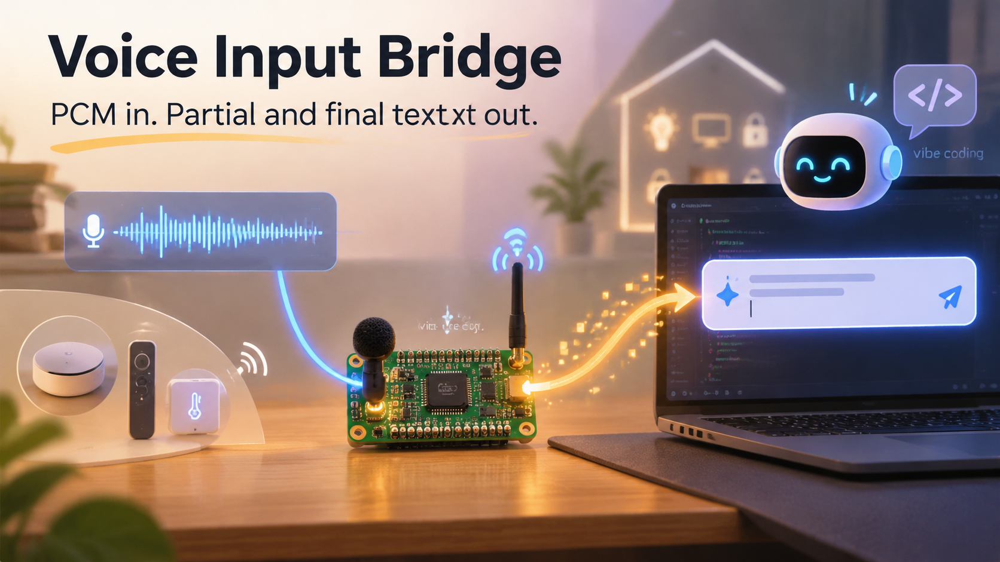
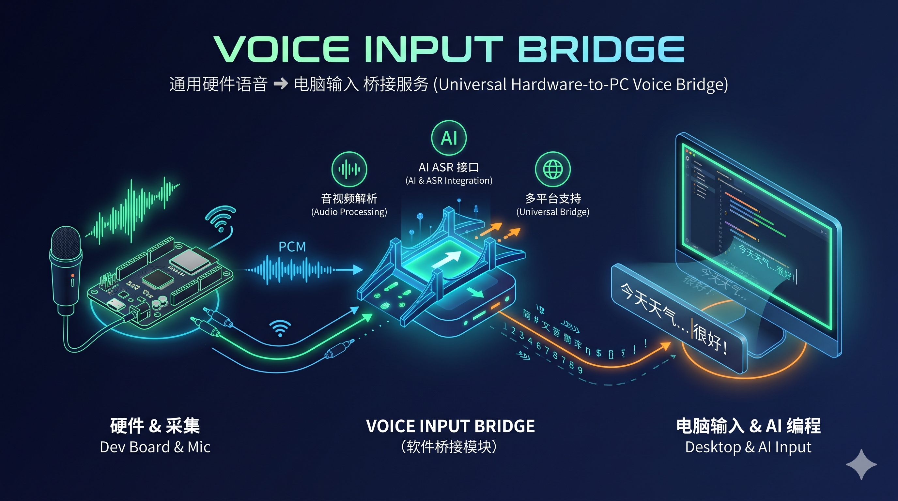
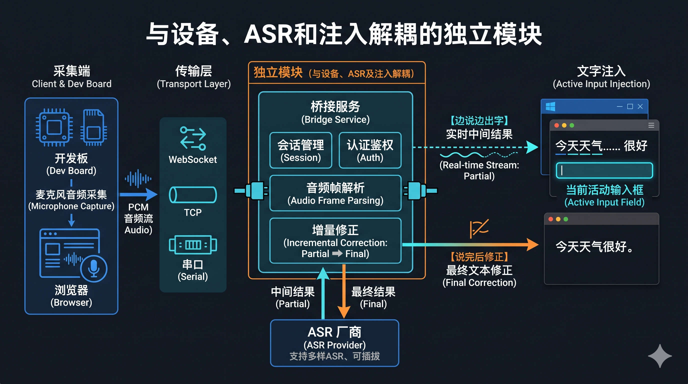
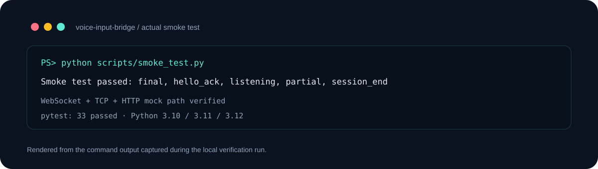

# Voice Input Bridge

**简体中文** | [English](README.en.md) | [Agent](docs/agent-deployment.md)



图 1：AI 生成的技术首图，展示设备音频、桥接服务、实时 ASR 与桌面输入框之间的关系，同时呈现 vibe coding 与智能家居硬件背景。它不是第三方产品截图，也不是运行证据。

Voice Input Bridge 是一个把各种外设的语音输入注入到桌面输入框的桥接服务。

如果你不懂以下内容，直接复制下面一段话给你的 agent，让它根据你的设备和网络情况完成配置：

```text
我正在使用 Voice Input Bridge（https://github.com/albertwickous-droid/voice-input-bridge）。请阅读 README 和 docs/hardware-setup.md，先判断我的设备适合有线 USB 串口、有线以太网、Wi-Fi 还是蓝牙；如果不确定，优先按有线 USB 串口方案给我一步步的安装、配置和验证命令。请明确列出需要安装的依赖、官方下载地址、需要修改的配置文件，以及如何在不提交 API key、token 和 Wi-Fi 密码的情况下完成测试。
```

> **不再为每台外设重写一套语音输入后端。** 只要设备能发送 PCM 音频，Voice Input Bridge 就能把云端或本地 ASR 的 `partial` / `final` 文字送进 Windows/macOS 当前输入框。

Voice Input Bridge（`vib`）是一个与设备、ASR 厂家和文字注入方式解耦的语音转文字桥接服务。ESP32、M5Stick、浏览器、手机或脚本通过 WebSocket、TCP 或串口发送录音；桥接层负责会话、格式协商、增量文本修正和前台窗口保护。

核心差异：

- **设备侧只负责音频**：不把云厂商 SDK、Windows API 或 macOS API 写进每一块开发板。
- **ASR 可替换**：内置阿里云 Paraformer、Deepgram、命令行 ASR 和 mock provider，也支持 Python entry-point 插件。
- **边说边出字**：支持 `partial` 中间结果和 `final` 最终结果；默认按共同前缀生成最小化回退/插入编辑。
- **默认本地优先**：监听地址默认为 `127.0.0.1`，没有遥测，也不会自动读取 `.env`。


> **独立项目声明：** 本项目与阿里云、Deepgram、Espressif、Arduino、M5Stack、Microsoft、Apple 均无隶属、赞助、授权或官方背书关系。第三方名称仅用于说明兼容性。详见 [第三方声明](THIRD_PARTY_NOTICES.md)。

## 为什么是现在 / Why now

趋势核验：**2026-11-19**

**当前最重要的用途是 vibe coding + 硬件编程。** 近期小米遥控器类 Agent 项目受到关注，说明开发者正在把语音、无线模块和真实设备控制串起来；这类项目是社区现象，不是本项目的功能或性能证明。本项目不绑定某款遥控器或某个固件，而是提供**独立的语音识别模块**：只要模块能采集并输出 PCM，无线（Wi-Fi/WebSocket/TCP）或有线（USB 串口）接入都可以复用同一套桥接、ASR 和文字注入能力。

对已有 M5StickS3 的用户，最低成本方案就是使用板载 MEMS 麦克风和 Wi-Fi，不再额外购买 ASR 模块；安装依赖后从 [M5StickS3 示例](examples/m5stick_s3_ws_dictation) 开始。若从零采购，常见低成本起点是 ESP32/ESP32-S3 开发板加 I2S 数字麦克风（如 INMP441），见 [硬件最低成本与依赖](docs/hardware-setup.md)。**硬件编程依赖需要你自己安装**；开发板只负责采集和发送音频，识别在桥接服务所在电脑或服务器上完成。



图 2：AI 生成的总体关系图，概括“硬件与采集 → 软件桥接模块 → 电脑输入与 AI 编程”三段路径，以及实时中间结果和最终文本修正。

| 变化 | 对目标用户的影响 | 本项目如何回应 | 一手来源 |
| --- | --- | --- | --- |
| Vibe coding 与硬件编程正在结合：开发者希望用自然语言快速驱动真实开发板和外设 | 每个硬件项目都重写一套语音 SDK、桌面注入和网络逻辑会重复且脆弱 | 把语音识别做成独立模块，设备只发送 PCM；桌面侧统一处理 ASR、partial/final 和输入框注入 | [M5StickS3 文档](https://docs.m5stack.com/en/core/StickS3)、[ESP32 Arduino Core](https://docs.espressif.com/projects/arduino-esp32/en/latest/installing.html) |
| 实时 ASR 服务已经提供流式 partial/interim 结果，而不是只能等待整段录音结束 | 用户期待边说边看到文字；但每家 SDK 的音频格式、事件和错误处理不同 | 用统一的 `TranscriptEvent` 接口隔离供应商差异 | [阿里云 Paraformer Realtime V2](https://help.aliyun.com/zh/model-studio/paraformer-real-time-speech-recognition-api)、[Deepgram Docs](https://developers.deepgram.com/docs/live-streaming-audio) |
| Windows 和 macOS 提供系统级键盘注入能力，但 API、权限和前台窗口语义完全不同 | 同一套设备固件不能可靠地直接适配所有桌面应用 | 将文字注入拆成 Windows `SendInput`、macOS Quartz 和剪贴板兜底后端 | [Microsoft SendInput](https://learn.microsoft.com/en-us/windows/win32/api/winuser/nf-winuser-sendinput)、[Apple CGEvent](https://developer.apple.com/documentation/coregraphics/cgevent) |
| ESP32、浏览器和移动端都可以持续采集 PCM 并通过 WebSocket 传输 | 设备可以只做麦克风和网络，不必集成每种 ASR/桌面 API | 提供 WebSocket、TCP、串口和 ESP32/M5StickS3 示例 | [ESP32 产品文档](https://www.espressif.com/en/products/socs/esp32)、[WebSocket 浏览器 API](https://websockets.spec.whatwg.org/) |

这些来源用于证明相关平台能力存在，不代表本项目拥有第三方背书，也不把行业趋势当作功能或性能证明。小米遥控器类项目的流行在这里只作为社区背景观察，不引用具体 star 数，也不作为质量证据。

## 适合与不适合

**适合：**

- 已有 ESP32、M5Stick、浏览器或脚本，希望把音频变成桌面输入文字。
- 需要中文实时听写，并希望以后可以更换 ASR 厂家而不重写设备固件。
- 需要一个本地可运行的桥接层，便于自己控制网络、凭据和前台窗口行为。
- 想把语音输入接到 Notepad、IDE、聊天窗口等普通前台文本框。

**不适合：**

- 需要识别任意音频文件、自动生成字幕或批量转写。
- 需要绕过应用权限、验证码、访问控制或系统安全边界。
- 要求所有平台、所有应用和所有 ASR 都达到完全相同的延迟与准确率。
- 不能接受云端音频上传，同时又没有部署本地流式 ASR。

## ASR 厂商与接入状态

先区分 **“服务商支持流式”** 和 **“本项目已经内置该服务商”**。目前只有 `aliyun`、`deepgram`、`mock` 和 `command` 是内置 provider；其他厂商不能只改一个 `provider = "厂商名"` 就工作，需要实现 provider 插件，或通过 `command` 适配厂商 CLI。

官方入口集中核验：**2026-11-19**。价格会随区域、模型、并发和免费额度变化，因此正文不复制易过期数字；点击每行的官方文档、控制台或价格入口确认当前条款。

| 类别 | 厂商 / 服务 | 本项目接入方式 | 流式能力 / 说明 | 官方入口 |
| --- | --- | --- | --- | --- |
| 国内 | 阿里云 Paraformer Realtime V2 | **内置 `aliyun`** | partial + final；中文实时听写 | [文档](https://help.aliyun.com/zh/model-studio/paraformer-real-time-speech-recognition-api) · [控制台](https://bailian.console.aliyun.com/) · [价格](https://help.aliyun.com/zh/model-studio/model-pricing) |
| 国内 | 腾讯云实时语音识别 | 需插件 / 自定义适配 | 官方流式识别接口；不是本项目内置 provider | [文档](https://cloud.tencent.com/document/product/1093) · [控制台](https://console.cloud.tencent.com/asr) · [计费](https://cloud.tencent.com/document/product/1093/35686) |
| 国内 | 讯飞实时语音转写 | 需插件 / 自定义适配 | 官方实时 WebSocket 接口；需按讯飞鉴权接入 | [文档](https://www.xfyun.cn/doc/asr/rtasr/API.html) · [控制台](https://console.xfyun.cn/) |
| 国内 | 百度智能云语音识别 | 需插件 / 自定义适配 | 按百度云接口实现鉴权和音频流 | [文档](https://cloud.baidu.com/doc/SPEECH/s/2k5dllqxj) · [产品/价格](https://cloud.baidu.com/product/speech/asr) |
| 国内 | 火山引擎流式语音识别 | 需插件 / 自定义适配 | 官方流式接口；需确认模型、区域和鉴权方式 | [文档](https://www.volcengine.com/docs/6561/1354869) · [产品/价格](https://www.volcengine.com/product/asr) |
| 国内 | 华为云 SIS 实时 ASR | 需插件 / 自定义适配 | 官方 Real-Time ASR 请求接口 | [文档](https://support.huaweicloud.com/intl/en-us/api-sis/sis_03_0029.html) · [产品/价格](https://www.huaweicloud.com/product/sis.html) |
| 国际 | Deepgram | **内置 `deepgram`** | partial + final；WebSocket linear16 | [文档](https://developers.deepgram.com/docs/live-streaming-audio) · [价格](https://deepgram.com/pricing) |
| 国际 | Microsoft Azure AI Speech | 需插件 / 自定义适配 | Speech SDK / streaming API；需按 SDK 接入 | [文档](https://learn.microsoft.com/en-us/azure/ai-services/speech-service/speech-to-text) · [价格](https://azure.microsoft.com/en-us/pricing/details/speech/) |
| 国际 | Google Cloud Speech-to-Text | 需插件 / 自定义适配 | Streaming Recognize；需实现 Google 认证和流式协议 | [文档](https://cloud.google.com/speech-to-text/docs/streaming-recognize) · [价格](https://cloud.google.com/speech-to-text/pricing) |
| 国际 | Amazon Transcribe Streaming | 需插件 / 自定义适配 | 官方 streaming API；需实现 AWS 签名和事件流 | [文档](https://docs.aws.amazon.com/transcribe/latest/dg/streaming.html) · [价格](https://aws.amazon.com/transcribe/pricing/) |
| 国际 | AssemblyAI | 需插件 / 自定义适配 | Universal Streaming WebSocket | [文档](https://www.assemblyai.com/docs/streaming/getting-started/transcribe-streaming-audio) · [价格](https://www.assemblyai.com/pricing) |
| 国际 | Speechmatics | 需插件 / 自定义适配 | Realtime API；需按官方 WebSocket 协议接入 | [文档](https://docs.speechmatics.com/speech-to-text/realtime/quickstart) · [价格](https://www.speechmatics.com/pricing) |
| 国际 | Soniox | 需插件 / 自定义适配 | Real-time transcription API | [文档](https://docs.soniox.com/stt/rt/real-time-transcription) · [价格](https://soniox.com/pricing/) |
| 国际 | OpenAI Speech to Text | 需插件 / 自定义适配 | 具体流式能力和模型接口以官方页面为准；本项目未内置 | [文档](https://platform.openai.com/docs/guides/speech-to-text) · [价格](https://openai.com/api/pricing/) |
| 本地 | whisper.cpp | **内置 `command` / final-only** | 常整段录音后返回；真正的流式需要独立插件或服务器模式 | [GitHub](https://github.com/ggml-org/whisper.cpp) |
| 本地 | faster-whisper | **内置 `command` / final-only** | 常按文件或分块推理；流式需要额外分块逻辑 | [GitHub](https://github.com/SYSTRAN/faster-whisper) |
| 本地 | FunASR | **内置 `command` / final-only** | 中文模型丰富；流式需使用其流式接口封装成 provider | [GitHub](https://github.com/modelscope/FunASR) |
| 本地 | Vosk | **内置 `command` / final-only** | 可离线；需自行处理模型、内存和流式分块 | [GitHub](https://github.com/alphacep/vosk-api) |
| 本地 | sherpa-onnx | 需插件 / 自定义适配 | 支持多平台本地推理；需按具体模型实现 provider | [GitHub](https://github.com/k2-fsa/sherpa-onnx) |
| 测试 | mock | **内置 `mock`** | 确定性 partial + final，不访问网络 | [本地文档](docs/providers.md) |


### 选择建议

- **希望开箱即用、中文实时听写**：选内置 `aliyun`。
- **希望开箱即用、多语言或国际网络**：选内置 `deepgram`。
- **已有腾讯云、讯飞、百度、火山、华为、Azure、Google、AWS、AssemblyAI、Speechmatics、Soniox 或 OpenAI 账号**：先写对应 provider 插件；不要误以为修改一个配置键就能接通。
- **完全离线、能接受说完再出字**：用内置 `command` 接 whisper.cpp、faster-whisper、FunASR 或 Vosk。
- **完全离线且需要边说边出字**：实现流式本地 provider，或使用 FunASR、sherpa-onnx 等项目的流式接口封装；`command` 本身不是流式适配器。

完整配置示例和 provider 接口见 [docs/providers.md](docs/providers.md)。

## 传输、注入和网络方案

这张表区分“协议或厂商已有能力”和“本项目已实现”：只有标记为“内置”的配置可以直接启用。其他方案需要插件、反向代理或系统配置。

### 连接模式分类（先看这里）

| 连接模式 | 包含方案 | 本项目状态 | 推荐顺序 | 适用与限制 |
| --- | --- | --- | --- | --- |
| 有线 | USB CDC 串口；有线以太网上的 TCP / WebSocket | 串口内置；TCP / WebSocket 可运行在有线 IP 网络上 | 1（最推荐） | 延迟和稳定性最好，适合开发板靠近电脑的固定部署。USB 串口要求设备直接发送 `AUD1` PCM 帧，不是 USB 麦克风/UAC。 |
| 无线 | 2.4 GHz Wi-Fi + WebSocket / TCP；浏览器 Web Audio | 内置 | 2 | 灵活、布线少，适合 ESP32/M5StickS3 和手机/浏览器客户端；需要配置 Wi-Fi、IP、token、防火墙，跨网段时用 TLS/VPN。 |
| 蓝牙 / BLE | 蓝牙麦克风、耳机、BLE 音频设备 | **未内置** | 3（暂不推荐） | 本项目不读取系统蓝牙麦克风；必须由设备端或独立采集客户端先转成 PCM。BLE 带宽、编解码和权限限制明显，不适合作为实时 PCM 首选。 |

**结论：** 如果设备就在电脑旁，优先选有线 USB 串口；需要移动或远离电脑时再用 Wi-Fi；蓝牙目前只适合作为自定义采集客户端的扩展方向，不是开箱即用路径。

| 类别 | 方案 | 适合场景 | 当前状态 / 配置 | 注意事项 | 参考 |
| --- | --- | --- | --- | --- | --- |
| 无线 | Wi-Fi / LAN 设备 | ESP32、M5Stick、手机或同一局域网内客户端 | 内置；通过 WebSocket 或 TCP 连接桥接服务 | 桥接服务需监听可达地址；跨设备时配置 token、防火墙和加密边界 | [ESP32 示例](examples/esp32/arduino_ws_mic)、[排错](docs/troubleshooting.md#websocket-fails-from-another-machine) |
| 蓝牙 | 蓝牙 / BLE 音频 | 蓝牙麦克风、耳机或 BLE 设备 | **未内置**；需设备端或独立客户端先采集并发送 PCM | 本项目不直接读取系统蓝牙麦克风；BLE 带宽、编解码和权限需自行处理 | [排错](docs/troubleshooting.md#the-microphone-is-not-the-default-device) |
| 有线 | USB 麦克风 / UAC | 普通 USB 麦克风或声卡 | **未内置**；需系统录音客户端转成 PCM 后发送 | USB 串口 transport 不是 USB 音频/UAC 采集 | [排错](docs/troubleshooting.md#the-microphone-is-not-the-default-device) |
| 无线 | 浏览器麦克风 | 浏览器页面内录音和本地测试 | 内置 Web Audio + WebSocket 示例 | 需要浏览器授权；页面通常要求 localhost 或 HTTPS | [浏览器示例](examples/clients/browser/index.html) |
| 协议 | WebSocket | 浏览器、ESP32、局域网设备、跨平台客户端 | 内置；`transports.websocket.enabled = true` | 反向代理后可提供 `wss://`；默认只监听 loopback | [WebSocket 标准](https://websockets.spec.whatwg.org/)、[协议文档](docs/protocol.md#transports) |
| 协议 | TCP | 简单设备、串口网关、无 WebSocket 栈的客户端 | 内置；`transports.tcp.enabled = true` | 明文协议；不要直接暴露公网 | [RFC 9293](https://www.rfc-editor.org/rfc/rfc9293.html)、[协议文档](docs/protocol.md#transports) |
| 有线 | USB 串口 | USB CDC 串口设备、开发板调试线 | 内置；`[transports.serial]`，`port = "auto"` | 不是 USB 麦克风/UAC；需要设备端按 `AUD1` 帧发送 | [pyserial 文档](https://pyserial.readthedocs.io/en/latest/)、[架构](docs/architecture.md#serial) |
| 网络 | UDP discovery | 局域网发现桥接服务 | 可选；`[transports.discovery] enabled = true` | 只发现地址，不认证、不加密，默认关闭 | [发现协议](docs/protocol.md#discovery) |
| 注入 | Windows 文字注入 | Windows 普通前台应用 | 内置 `input.backend = "windows"` | 前台窗口保护；不能向更高权限窗口注入 | [Microsoft SendInput](https://learn.microsoft.com/en-us/windows/win32/api/winuser/nf-winuser-sendinput) |
| 注入 | macOS 文字注入 | macOS 普通前台应用 | 内置 `input.backend = "macos"` | 需要 Accessibility 权限；需真实 macOS 验证 | [Apple CGEvent](https://developer.apple.com/documentation/coregraphics/cgevent) |
| 注入 | 剪贴板兜底 | final-only、其他输入后端不可用 | 内置 `input.backend = "clipboard"` | 不能可靠保护前台窗口，必须显式 `require_same_window = false` | [输入后端说明](docs/architecture.md#clipboard) |
| 调试 | stdout / null | 调试、CI、协议测试 | 内置 `stdout` / `null` | 不触碰真实输入框 | [架构](docs/architecture.md#components) |
| 注入 | 自定义 InputSink | 特殊应用或远程注入 | `backend = "module:Class"` 插件 | 需要实现 `TextSink` 接口并自行审计权限边界 | [扩展说明](docs/architecture.md#add-a-text-sink) |
| 网络边界 | 本机直连 | 单机使用 | 默认 `127.0.0.1` | 最小暴露面，推荐默认 | [安全说明](SECURITY.md) |
| 网络边界 | LAN + token | 可信局域网设备 | `host = "0.0.0.0"` + token + 防火墙 | token 只认证，不加密；先确认局域网边界 | [安全说明](SECURITY.md) |
| 网络边界 | TLS 反向代理 / WSS | 跨网段或浏览器 HTTPS 页面 | WebSocket 前置 TLS 代理 | 不要让明文 WebSocket 直接暴露公网 | [TLS 1.3 RFC](https://www.rfc-editor.org/rfc/rfc8446.html) |
| 网络边界 | VPN / Tailscale / WireGuard | 远程设备接入家庭或办公机 | 网络层加密 | 仍需应用层 token 和最小权限 | [Tailscale](https://tailscale.com/)、[WireGuard](https://www.wireguard.com/) |
| 平台 | Linux 原生文字注入 | Linux 桌面输入框 | **未内置**；可用 `stdout`、剪贴板或自定义 `InputSink` | 不要把 Linux 核心运行能力写成原生注入能力 | [输入后端](docs/architecture.md#input-backends) |

> **重要边界：** 本项目不是系统麦克风采集器，也不会自动读取“默认麦克风”或蓝牙耳机。音频必须由设备、浏览器、脚本或你自行实现的采集客户端转换为 PCM，再通过 WebSocket、TCP 或串口送入桥接服务。



图 3：AI 生成的详细架构示意图，展示采集端、WebSocket/TCP/串口、桥接服务、ASR 厂商和文字注入之间的关系；`partial → diff → final` 是项目实际采用的事件流程。

## 能力矩阵

| 层次 | 当前能力 | 可核对证据 |
| --- | --- | --- |
| 环境 | Python 3.10+；Windows 与 macOS 文字注入；Linux 可运行核心与 stdout/剪贴板路径 | `pyproject.toml`、`doctor`、CI matrix |
| 设备输入 | ESP32、M5StickS3、浏览器 Web Audio、Python 客户端 | `examples/` 下的示例 |
| 传输 | WebSocket、TCP、可选 USB 串口、可选 UDP 发现 | `src/voicebridge/transports/` |
| 音频协议 | PCM S16LE、`AUD1` 二进制帧、JSON 控制消息 | `docs/protocol.md`、协议测试 |
| 生命周期 | `hello` → `start` → `listening` → `partial`/`final` → `session_end` | WebSocket/TCP 端到端测试 |
| 等待和断言 | provider final、最大录音时长、前台窗口保护、输入失败告警 | `service.py`、`input/base.py`、异常测试 |
| ASR | `mock`、阿里云、Deepgram、`command`、entry-point 插件 | `docs/providers.md` |
| 产物证据 | 事件流、`/health`、`/v1/status`、smoke test 输出、wheel/sdist | `docs/`、`scripts/`、`dist/` |

## 从目标到入口

| 我想做什么 | 入口 |
| --- | --- |
| 检查环境、依赖、凭据和端口 | `voicebridge doctor --config config.demo.toml` |
| 不调用云服务的本地验证 | `python scripts/smoke_test.py` |
| 启动桥接服务 | `voicebridge serve --config config.toml` |
| 通过 WebSocket 发送测试 PCM | `voicebridge simulate --target ws://127.0.0.1:18766/v1/audio` |
| 查看可用 ASR provider | `voicebridge providers` |
| 查看脱敏后的有效配置 | `voicebridge config --config config.toml --json` |
| 接 ESP32 / M5StickS3 | `examples/esp32/`、`examples/m5stick_s3_ws_dictation/` |
| 在浏览器里测试麦克风 | `examples/clients/browser/index.html` |

## 最短可验证路径

下面的流程使用 `mock` provider，不调用付费 API，也不会向前台输入框注入文字。

### 安装

```powershell
git clone https://github.com/albertwickous-droid/voice-input-bridge.git
cd voice-input-bridge
python -m venv .venv
.\.venv\Scripts\Activate.ps1
python -m pip install -e ".[dev]"
```

macOS 或 Linux 将激活命令改为：

```bash
source .venv/bin/activate
```

### 预检和自动验证

```powershell
voicebridge doctor --config config.demo.toml
python scripts/smoke_test.py
```

期望结果是：

```text
Smoke test passed: final, hello_ack, listening, partial, session_end
```

这个 smoke test 会自己启动临时服务、建立 WebSocket、发送 PCM、检查 `partial` / `final` / `session_end`，完成后停止临时服务。



图 4：由本地实际执行 `scripts/smoke_test.py` 生成的终端记录，证明测试已运行，不是静态配置检查。

### 启动演示服务

终端一：

```powershell
voicebridge serve --config config.demo.toml
```

终端二：

```powershell
voicebridge simulate --target ws://127.0.0.1:18766/v1/audio
```

也可以访问：

- <http://127.0.0.1:18765/health>
- <http://127.0.0.1:18765/v1/status>
- <http://127.0.0.1:18765/v1/protocol>

## 真正开始输入

复制示例配置：

```powershell
Copy-Item config.example.toml config.toml
```

Windows 使用 Win32 `SendInput`：

```toml
[asr]
provider = "aliyun"

[input]
backend = "windows"
send_partial = true
require_same_window = true
```

macOS 使用 Quartz：

```toml
[input]
backend = "macos"
```

macOS 需要在“系统设置 → 隐私与安全性 → 辅助功能”中授予 Python 或打包应用权限。Windows 桥接进程不能向管理员权限更高的窗口注入文字。

设置云端凭据时只用环境变量，不要把 key 写进 README、配置文件或 Git：

```powershell
$env:DASHSCOPE_API_KEY = "..."
$env:DASHSCOPE_WORKSPACE_ID = "..."
voicebridge doctor --config config.toml
voicebridge serve --config config.toml
```

Deepgram 使用 `DEEPGRAM_API_KEY`。本地 whisper.cpp、faster-whisper、FunASR 等可以通过 `command` provider 接入；命令行 provider 通常是整段录音结束后才返回 final，不是真正的流式返回。

## 自己的设备怎么开始

1. 从 `examples/esp32/arduino_ws_mic` 或 `examples/m5stick_s3_ws_dictation` 开始。
2. 修改 Wi-Fi SSID、密码、桥接服务地址和本机端口；不要把这些值提交到仓库。
3. 确认设备发送 `hello`、`start`、`AUD1` PCM 帧和 `stop`。
4. 在桌面端配置对应 provider 和 `input.backend`。
5. 先用 `voicebridge simulate` 验证桥接服务，再接真实设备。

协议细节见 [docs/protocol.md](docs/protocol.md)，设备示例见 [examples/README.md](examples/README.md)。

## 产物说明

本项目不是一个 HTML 报告工具，因此没有 UI 树、logcat 或 HTML 报告产物。实际可检查的产物是：

- WebSocket/TCP 事件：`hello_ack`、`listening`、`partial`、`final`、`session_end`。
- HTTP 状态：`/health`、`/v1/status`、`/v1/protocol`。
- `scripts/smoke_test.py` 的终端输出和退出码。
- Python 发布制品：`dist/*.whl` 和 `dist/*.tar.gz`。
- 设备端音频格式、帧序号、丢弃字节数和首字延迟等会话状态。

事件字段和错误码见 [docs/protocol.md](docs/protocol.md)。

## 可复现证据

| 检查 | 结果 |
| --- | --- |
| `python -m pytest -q` | **33 passed** |
| Python 3.10 / 3.11 / 3.12 | 均通过 33 项测试 |
| `python -m ruff check .` | 通过 |
| `python scripts/smoke_test.py` | 通过：`final, hello_ack, listening, partial, session_end` |
| `python scripts/check_release.py` | wheel、sdist、twine 和干净环境入口检查通过 |
| 设备示例 | ESP32 与 M5StickS3 源码已提供；本次发布检查未把 Arduino 工具链作为必过项 |
| Windows SendInput 结构测试 | Windows 下的 `INPUT` 结构尺寸测试通过；不同目标应用仍需单独验证 |

这些结果来自 2026-11-18 至 2026-11-19 的本地验证。它们不代表所有硬件、所有 macOS 版本或所有云端 provider 都已验证。

## 已知限制

- macOS Quartz 需要在真实 macOS 机器上逐版本验证；当前开发验证主要在 Windows 完成。
- USB 串口 transport 已有代码和单元测试，但尚未在所有真实 USB CDC 设备上验证。
- `command` provider 的 final 延迟取决于外部程序，通常需要等录音结束。
- 云端 ASR 受网络、区域、模型、配额和计费影响；provider 事件格式也可能变化。
- 静态 token 只做身份校验，不加密传输；默认监听 loopback，跨设备使用时应放在可信局域网、VPN 或 TLS 反向代理之后。
- ESP32/M5StickS3 示例的麦克风引脚、板卡 FQBN 和库版本必须按实际硬件修改。

## 安全、隐私与责任

- 默认只监听 `127.0.0.1`；开放到网络前必须自行配置 token、防火墙和加密边界。
- 不要把 API key、Wi-Fi 密码、token、cookie、私钥、设备序列号、个人路径或真实录音提交到仓库。
- `voicebridge` 不自动读取 `.env`。凭据应通过环境变量或外部秘密存储注入。
- 使用云端 ASR 时，音频会发送给对应供应商；请自行确认账号、区域、隐私、计费和数据处理条款。
- 本项目只应用于获授权的设备、账号、应用和数据。不要把语音注入宣传成绕过权限、验证码或访问控制的能力。
- 安全问题请通过仓库的 GitHub Security Advisory 私密报告，不要在公开 Issue 中粘贴密钥或真实音频。详见 [安全说明](SECURITY.md)、[隐私说明](PRIVACY.md) 和 [责任使用](RESPONSIBLE_USE.md)。

## 文档与许可证

- [English README](README.en.md)
- [Agent deployment guide](docs/agent-deployment.md)
- [协议](docs/protocol.md)
- [ASR provider](docs/providers.md)
- [排错](docs/troubleshooting.md)
- [硬件最低成本与依赖](docs/hardware-setup.md)
- [视觉资源提示词](docs/image-prompts.md)
- [安全说明](SECURITY.md)
- [隐私说明](PRIVACY.md)
- [免责声明](DISCLAIMER.md)
- [责任使用](RESPONSIBLE_USE.md)
- [第三方声明](THIRD_PARTY_NOTICES.md)
- [问题与支持](SUPPORT.md)
- [贡献指南](CONTRIBUTING.md)

许可证：**MIT**。详见 [LICENSE](LICENSE)。
