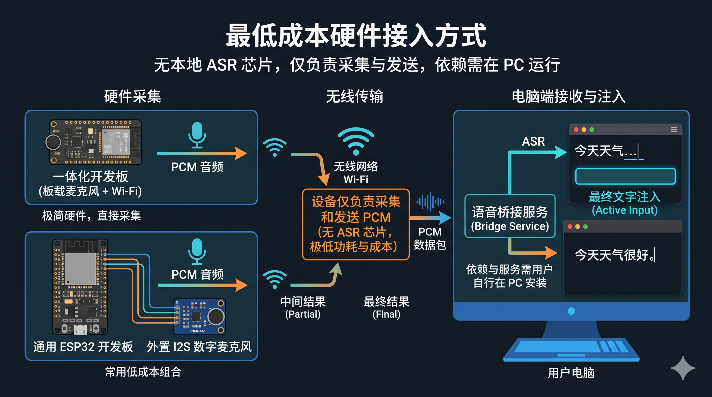

# 硬件最低成本方案与依赖

本项目把**语音识别从开发板里拆出来**。开发板只负责采集 PCM 并通过 Wi-Fi/WebSocket/TCP 或 USB 串口发送；识别、增量文本修正和输入框注入都在运行 `voicebridge` 的电脑或服务器上完成。因此不需要在本地开发板上跑 ASR 模型，也不需要额外购买云端 ASR 硬件模块。

> **先安装依赖：** 硬件编程所需的 Arduino 板卡包、库和驱动需要你自行安装。本仓库只提供示例源码，不打包这些第三方工具链。

## 最低成本与最低复杂度怎么选

| 场景 | 推荐方案 | 还需要购买什么 | 连接方式 | 对应示例 |
| --- | --- | --- | --- | --- |
| 已经在使用 M5StickS3 | 直接用板载 MEMS 麦克风 + 2.4 GHz Wi-Fi | **不需要额外音频模块** | Wi-Fi + WebSocket | [`examples/m5stick_s3_ws_dictation`](../examples/m5stick_s3_ws_dictation) |
| 从零开始、希望通用且便宜 | ESP32/ESP32-S3 开发板 + I2S 数字麦克风（如 INMP441） | 开发板、I2S 麦克风、少量接线 | Wi-Fi + WebSocket | [`examples/esp32/arduino_ws_mic`](../examples/esp32/arduino_ws_mic) |
| 没有 Wi-Fi 或不方便连局域网 | 任意能输出 PCM 的开发板 + USB 串口 | USB 线、按协议实现串口帧 | USB serial | [协议文档](protocol.md#transports) |

如果板载麦克风已经能满足需求，M5StickS3 路径通常是最省事也最省钱的：不用另接麦克风，不用本地 ASR 芯片，只要装好 Arduino 依赖、填好 Wi-Fi 和桥接服务地址即可。若从零采购，ESP32/ESP32-S3 + INMP441 是常见的低成本起点；它不是“语音识别模块”，只是音频采集模块，识别仍由本项目在电脑侧完成。

图 1：AI 生成的硬件接入示意图。两条路径分别是一体化开发板直接采集，以及通用 ESP32 加外置 I2S 数字麦克风；两者都只负责采集与发送 PCM，识别与依赖运行在电脑侧。

## 官方下载地址与依赖入口

### 通用工具

- Arduino IDE：<https://www.arduino.cc/en/software>
- Arduino 库安装说明：<https://docs.arduino.cc/libraries/>
- M5Stack Arduino IDE 配置文档：<https://docs.m5stack.com/en/arduino/arduino_ide>
- M5Stack 板卡管理地址：<https://static-cdn.m5stack.com/resource/arduino/package_m5stack_index.json>
- M5StickS3 产品文档：<https://docs.m5stack.com/en/core/StickS3>
- Espressif Arduino-ESP32 安装文档：<https://docs.espressif.com/projects/arduino-esp32/en/latest/installing.html>
- Espressif 板卡管理地址：<https://espressif.github.io/arduino-esp32/package_esp32_index.json>

### 示例所需库

- M5Unified（M5StickS3 示例）：<https://github.com/m5stack/M5Unified>
- WebSockets by Markus Sattler / arduinoWebSockets（两个示例都需要）：<https://github.com/Links2004/arduinoWebSockets>
- ESP32 I2S driver（ESP32 示例使用 Arduino-ESP32 自带 API，无需单独安装）：<https://docs.espressif.com/projects/arduino-esp32/en/latest/api/i2s.html>

第三方链接仅用于说明安装来源；这些项目不属于 Voice Input Bridge，也不代表其背书。

## M5StickS3 最短上手步骤

1. 安装 Arduino IDE。
2. 在板卡管理器中添加 M5Stack 板卡管理地址，并安装对应 ESP32/M5Stack 板卡包；也可按 [M5Stack 官方 Arduino 文档](https://docs.m5stack.com/en/arduino/arduino_ide)操作。
3. 通过库管理器安装 `M5Unified` 和 `WebSockets`（作者 Markus Sattler）。
4. 打开 [`examples/m5stick_s3_ws_dictation/m5stick_s3_ws_dictation.ino`](../examples/m5stick_s3_ws_dictation/m5stick_s3_ws_dictation.ino)。
5. 只在本机修改 Wi-Fi SSID、密码、桥接服务 IP、端口和 token。**不要提交真实凭据。**
6. 选择 M5StickS3 板卡和正确串口，编译上传。
7. 电脑侧启动桥接服务，然后按住按键 A 说话；文字应出现在当前输入框。

## ESP32 + I2S 麦克风最短上手步骤

1. 安装 Arduino IDE。
2. 在板卡管理器中添加 Espressif 板卡管理地址，安装 `esp32` 板卡包。
3. 安装 `WebSockets`（Markus Sattler）。
4. 打开 [`examples/esp32/arduino_ws_mic/arduino_ws_mic.ino`](../examples/esp32/arduino_ws_mic/arduino_ws_mic.ino)。
5. 按实际接线修改 I2S BCLK、WS、DIN 和 PTT 引脚，并填写 Wi-Fi 与桥接服务信息。
6. 编译上传后先用 `voicebridge simulate` 验证桥接服务，再接真实设备。

## 边界说明

- 本项目当前**不直接读取电脑的默认麦克风、蓝牙耳机或 USB 麦克风**；音频必须由设备端或独立采集客户端转成 PCM 后送入桥接服务。
- 如果你已有能直接输出文字的离线 ASR 模块，那不是本项目的 PCM 输入路径；需要把它的文字输出适配为 provider，或使用 `command` provider 包一层。
- 云端 ASR 会产生网络流量和费用；本地识别需要自行准备模型与算力。价格、模型和区域限制请以厂商官方页面为准。
